# TareoApp

**Sistema de tareo y asistencia laboral para Android**, con marcaje por GPS dentro de una geocerca, detección de ubicación falsa, funcionamiento sin conexión y reportes de horas, tardanzas y faltas.

Construido con **Kotlin + Jetpack Compose**, arquitectura **MVVM + Clean Architecture** y enfoque **offline-first**.

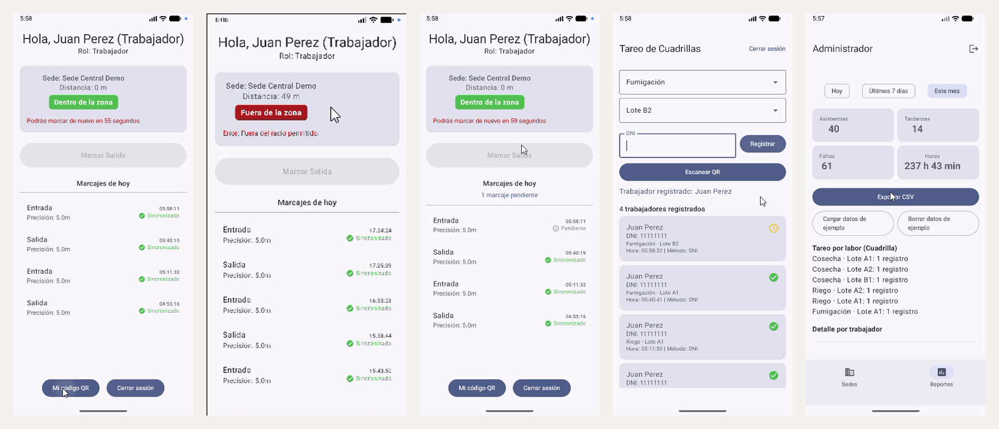

---

## El problema

En operaciones de campo (agro, construcción, logística) el control de asistencia suele hacerse en papel o con apps que fallan en tres puntos:

1. **El trabajador marca desde cualquier lugar**, o usa una app de GPS falso.
2. **No hay señal** en el lugar de trabajo y el marcaje se pierde.
3. **Muchos trabajadores no tienen smartphone**, así que un tareador debe registrar a toda la cuadrilla.

TareoApp resuelve los tres.

## Funcionalidades

### Trabajador
- Marca **entrada y salida** solo si está **dentro del radio** de una sede (geocerca).
- La app elige automáticamente la **sede activa más cercana**.
- **Antifraude**: rechaza ubicaciones simuladas, precisión de GPS baja y marcajes repetidos (mínimo 1 minuto entre marcajes).
- **Hora confiable**: cada marcaje guarda también `elapsedRealtime`, que no se puede alterar cambiando la hora del teléfono.
- **Sin conexión**: el marcaje se guarda en el teléfono como *Pendiente* y se sincroniza solo al volver la señal.
- **Mi código QR**: muestra su DNI en QR para que el tareador lo escanee.

### Tareador
- Registra la asistencia de una **cuadrilla** indicando **labor** y **lote**.
- Registro por **DNI** o **escaneo de código QR** (CameraX + ML Kit).
- Evita duplicados: un trabajador no puede registrarse dos veces el mismo día en la misma labor y lote.

### Administrador
- **Sedes**: crear, editar, activar o desactivar y eliminar sedes; definir el radio de la geocerca (20 a 1000 m) o usar la ubicación actual. Los cambios se reflejan en tiempo real en el trabajador.
- **Reportes** por rango (Hoy, Últimos 7 días, Este mes): asistencias, tardanzas, faltas y horas trabajadas, con detalle por trabajador y por día.
- **Tareo por labor**: registros de cuadrilla agrupados por labor y lote.
- **Exportar a CSV** compatible con Excel (UTF-8 con BOM, separador `;`).

## Demo

<p align="center">
  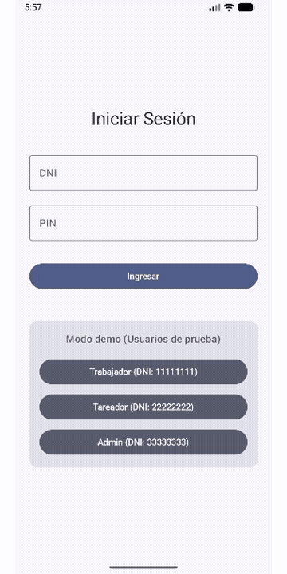
</p>

| Login con modo demo | Dentro de la zona | Fuera de la zona |
|:---:|:---:|:---:|
| 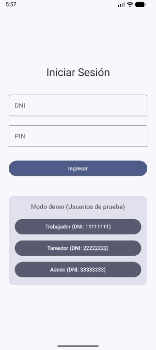 | 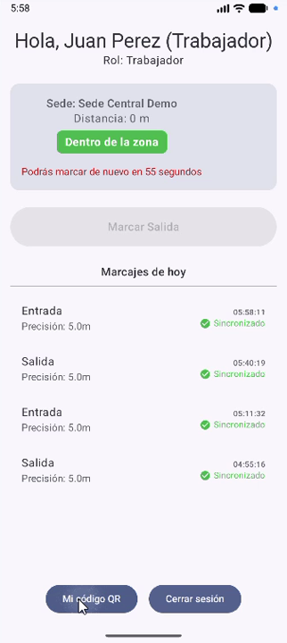 | 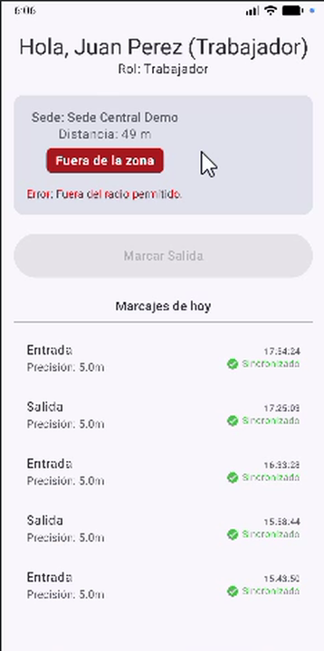 |

| Marcaje sin conexión | Mi código QR | Tareo de cuadrilla |
|:---:|:---:|:---:|
| 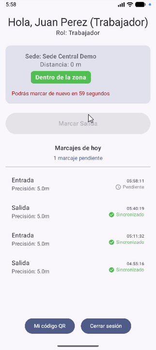 | 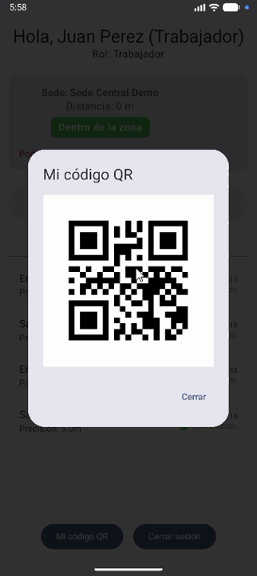 | 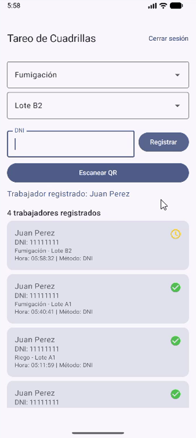 |

| Gestión de sedes | Reportes | Detalle por trabajador |
|:---:|:---:|:---:|
| 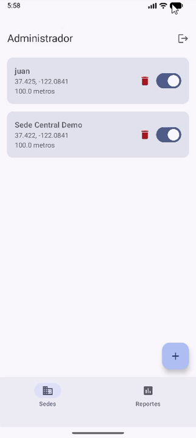 | 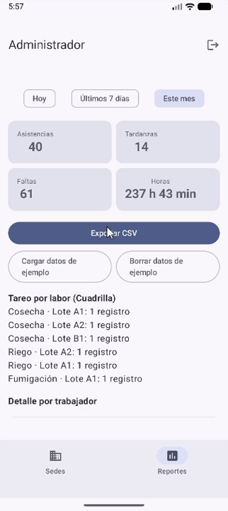 | 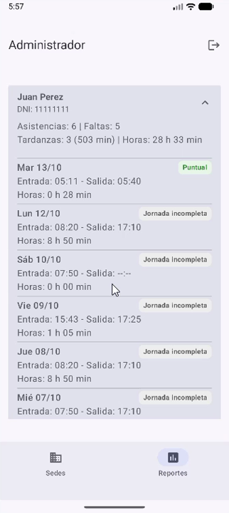 |

## Arquitectura

La app sigue la arquitectura recomendada por Google: cada capa tiene una sola responsabilidad y depende solo de la capa de abajo.

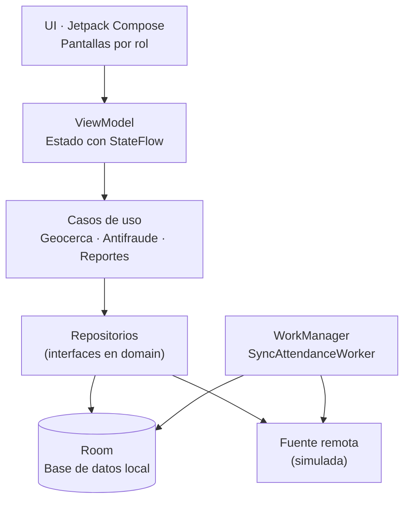

### Flujo offline-first

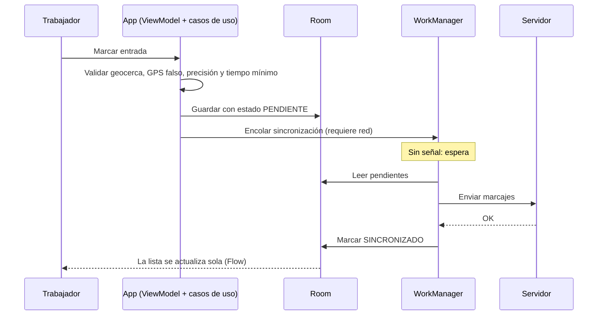

### Estructura del proyecto

```
app/src/main/java/com/dangeloretis/tareoapp/
├── data/
│   ├── local/        # Room: entidades, DAO, base de datos y migraciones
│   ├── remote/       # Fuentes remotas (simuladas)
│   └── repository/   # Implementaciones de los repositorios
├── domain/
│   ├── model/        # Modelos de negocio
│   ├── repository/   # Interfaces
│   └── usecase/      # Reglas de negocio
├── di/               # Módulos de Hilt
└── ui/
    ├── navigation/   # Rutas type-safe
    └── screens/      # Login, Trabajador, Tareador, Admin
```

## Stack técnico

| Área | Tecnología |
|---|---|
| Lenguaje | Kotlin |
| UI | Jetpack Compose, Material 3, Navigation Compose (rutas type-safe) |
| Arquitectura | MVVM + Clean Architecture, offline-first |
| Inyección de dependencias | Hilt (con KSP) |
| Persistencia | Room, con migraciones versionadas y esquemas exportados |
| Asincronía | Kotlin Coroutines y Flow |
| Trabajo en segundo plano | WorkManager + Hilt Worker |
| Ubicación | Fused Location Provider (Play Services) |
| Cámara y QR | CameraX + ML Kit Barcode Scanning, ZXing para generar QR |
| Pruebas | JUnit, pruebas de DAO y de migración de Room (instrumentadas) |

## Decisiones técnicas destacadas

- **Geocerca con fórmula de distancia** (`Location.distanceBetween`) y validación de precisión mínima del GPS.
- **Detección de GPS falso** con `Location.isMock` (API 31+) y `isFromMockProvider` en versiones anteriores.
- **Hora confiable para marcajes sin señal**: se guarda `System.currentTimeMillis()` y `SystemClock.elapsedRealtime()`; la regla de tiempo mínimo entre marcajes usa `elapsedRealtime` y tiene respaldo si el equipo se reinició.
- **Validación en el momento exacto del marcaje**, protegida con `Mutex` para evitar dobles registros por toques repetidos.
- **Migraciones de Room sin pérdida de datos** (v1 → v2 → v3), cubiertas por pruebas con `MigrationTestHelper`.
- **Reglas de reportes testeables** con un reloj inyectable: no se cuentan domingos ni faltas del día actual antes de la hora de entrada.

## Cómo probarlo

1. Clona el repositorio y ábrelo en **Android Studio** (versión reciente, con AGP 9).
2. Ejecuta la app en un emulador con **Google Play** (API 26 o superior).
3. Inicia sesión con un usuario demo:

| Rol | DNI | PIN |
|---|---|---|
| Trabajador | `11111111` | `1111` |
| Tareador | `22222222` | `2222` |
| Administrador | `33333333` | `3333` |

### Probar la geocerca en el emulador

La sede demo está en la ubicación por defecto del emulador. Desde la terminal de Android Studio (Windows/PowerShell):

```powershell
# Dentro de la sede
& "$env:LOCALAPPDATA\Android\Sdk\platform-tools\adb.exe" emu geo fix -122.0841 37.4220

# A unos 50 metros (fuera de la zona si el radio es 20 m)
& "$env:LOCALAPPDATA\Android\Sdk\platform-tools\adb.exe" emu geo fix -122.0841 37.42245
```

### Probar el modo sin conexión

1. Como trabajador, activa el **modo avión** y marca: el registro queda como **Pendiente**.
2. Desactiva el modo avión: en unos segundos pasa a **Sincronizado**.

### Probar los reportes

Como administrador, en **Reportes**, toca **Cargar datos de ejemplo** para generar una semana de marcajes con tardanzas, faltas y jornadas incompletas.

## Pruebas automáticas

```bash
# Pruebas unitarias (casos de uso, reglas de negocio, mappers)
./gradlew testDebugUnitTest

# Pruebas instrumentadas (DAO y migraciones de Room) — requiere emulador
./gradlew connectedDebugAndroidTest
```

## Próximos pasos

- API REST propia (Retrofit) para reemplazar la fuente remota simulada.
- Validación de geocerca también en el servidor.
- Confirmación biométrica o selfie al marcar.
- Pipeline de integración continua con GitHub Actions.

## Autor

**Dangelo Retis** · [GitHub](https://github.com/DRXD13)
